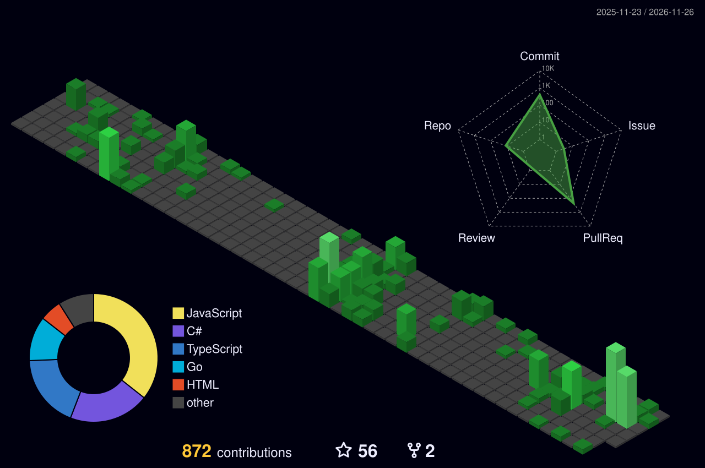

  

  

  
  
  

---

## About

Backend C# for about ten years. Three jobs:

- **Elbit** (2014-18). Instructor consoles for military simulators. WPF.
- **KLA** (2019-24). Cleanroom inspection tools for semiconductor fabs. Lots of fab travel.
- **WEM** (2025-now). Leading the software side of grid-scale battery storage. C# microservices, React, PostgreSQL. Some LLM integration too (Claude, Gemini, MCP).

More at [eladser.dev](https://eladser.dev).

---

## Projects

### [Seerlens](https://github.com/eladser/seerlens)

Diff your AI calls locally, see what they really cost, and fail CI when quality or cost regresses. Pick two runs and the steps line up side by side, with what changed in the prompt, the tool calls, the model, tokens, cost, and latency. Cost counts cached and reasoning tokens and shows the cache hit rate. `seerlens eval` fails the build when the eval score drops or a run costs more than the baseline allows. It also has a trace timeline, model comparison, and cost budgets.

ASP.NET Core 10 + SQLite + React, built on OpenTelemetry. Takes spans from any language, with SDKs for .NET, Python, and JavaScript; runs as a self-contained binary or a dotnet tool.

[source](https://github.com/eladser/seerlens), [nuget](https://www.nuget.org/packages/Seerlens), [pypi](https://pypi.org/project/seerlens/), [npm](https://www.npmjs.com/package/seerlens)

### [mtop](https://github.com/eladser/mtop)

htop for your local AI. One terminal window over whatever model server you're running (Ollama, llama.cpp, LM Studio, vLLM, llama-swap, Lemonade, SGLang), showing loaded models and their VRAM, the GPU, and requests with tok/s while they stream. It evicts models that won't unload on their own, and a pass-through proxy reads the per-request numbers straight off the wire (also Prometheus `/metrics`). When a model is slow it says why: spilled to CPU, context full, requests queueing. `mtop compare` benchmarks a prompt across models, and `mtop --demo` runs on simulated models if you don't have a server up.

Go. `brew install eladser/tap/mtop`, `scoop install mtop`, or `winget install eladser.mtop`.

[source](https://github.com/eladser/mtop)

### [AeroLens](https://aerolens.eladser.dev)

Real-time flight tracker. Predicts delays through a Groq, Mistral, Gemini fallback chain. You add your trips and it pings you when something changes.

React 19 + ASP.NET Core 8 + SignalR. Vercel, Northflank, Supabase, Upstash.

[live](https://aerolens.eladser.dev), [source](https://github.com/eladser/AeroLens)

### [Halcyon Airways](https://y2k.eladser.dev)

A made-up airline's homepage, built eight times, from 1996 to 2026. Each one is made with that year's tools and runs inside that year's Windows and browser. You dial in for 1999, 2001 is a Flash site rebuilt without Flash, 2012 runs the real Bootstrap 2, and 2026 answers questions with Gemini Nano on your machine. The X-ray panel shows how each version was built, with code from the time.

Plain HTML, CSS and JavaScript, no build step. The modem and the Flash soundtrack are synthesized with Web Audio.

[live](https://y2k.eladser.dev), [source](https://github.com/eladser/y2k)

### [ASP.NET Debug Dashboard](https://github.com/eladser/AspNetDebugDashboard)

Laravel Telescope, but for .NET. Drop the NuGet into an ASP.NET Core app, add two lines, and `/_debug` shows every request with the EF Core queries and outgoing HTTP calls it made, plus logs, exceptions, and dumped objects. Each request opens on a timeline with all of that on one time axis, N+1 and slow queries highlighted. Replay resends a captured request, edited or not, and compares it with the original. Storage is a local LiteDB file and the whole UI ships inside the package as one offline HTML page.

Runs on .NET 8, 9, 10, and 11. Sibling packages for mail, feature flags, background jobs, and vitals share its sidebar, and an MCP server lets a coding agent read all of it.

[source](https://github.com/eladser/AspNetDebugDashboard), [nuget](https://www.nuget.org/packages/AspNetDebugDashboard)

### [SimpleConfigDiff](https://eladser.github.io/SimpleConfigDiff/)

Diff config files by structure, not by line, so a reordered YAML key or `"true"` vs `true` isn't a difference worth reading. Ten formats (JSON, YAML, TOML, XML, INI, ENV, Java properties, HCL, CSV, conf), and you can diff across them. Runs in the browser, installs as a PWA, or `npx simple-config-diff` in CI, where it exits non-zero on differences. Nothing leaves your machine.

React 19 + TypeScript + Vite.

[live](https://eladser.github.io/SimpleConfigDiff/), [source](https://github.com/eladser/SimpleConfigDiff), [npm](https://www.npmjs.com/package/simple-config-diff)

### [.NET Tools](https://eladser.github.io/.net-tools/)

Twenty-five browser tools for .NET work: JSON to C# classes (with `[JsonPropertyName]` and date/GUID detection), GUID v4/v7, a cron builder, JWT decoder, connection strings for six databases, a TFM/version reference table, plus the usual encoders and hashes. All client-side, nothing leaves the page, and it installs as an offline app.

React 19 + TypeScript + Vite.

[live](https://eladser.github.io/.net-tools/), [source](https://github.com/eladser/.net-tools)

### [WoW Tools](https://eladser.github.io/wow-tools/)

A side project, away from the day job. Mythic+, raid, and PvP utilities for the current World of Warcraft season: a score planner that reads your raider.io runs and picks the cheapest keys toward a target, a Great Vault planner, character compare, title cutoff, affix schedule, raid buff matrix. Live character data from raider.io, the rest computed in the browser.

React 19 + TypeScript + Vite.

[live](https://eladser.github.io/wow-tools/), [source](https://github.com/eladser/wow-tools)

---

## Stack

| Area | What I reach for |
|---|---|
| Backend | C#, .NET, ASP.NET Core, EF Core, SignalR, Go |
| Frontend | React, TypeScript, Tailwind, Vite |
| Database | PostgreSQL, SQL Server, MongoDB |
| Cloud / infra | AWS, Azure, Docker, Terraform |
| AI / LLM | Claude, Gemini, Groq, Mistral, MCP servers, agents/skills |

Older stuff: WPF, WCF, C++, Java from Elbit. Blazor, Angular from KLA.

---

## Currently

- WEM platform. Leading two engineers on grid-scale battery dispatch.
- LLM integration. MCP servers, agent orchestration, fallback patterns.
- Seerlens. A local tool for diffing LLM calls, pricing them, and gating CI on them. Current side project.
- If you're building dev tooling and want a second pair of hands, say hi.

---

## Stats

  
  

  

  

  

  

---

  <a href="https://eladser.dev">eladser.dev</a> · <a href="mailto:elad.ser@gmail.com">elad.ser@gmail.com</a>

